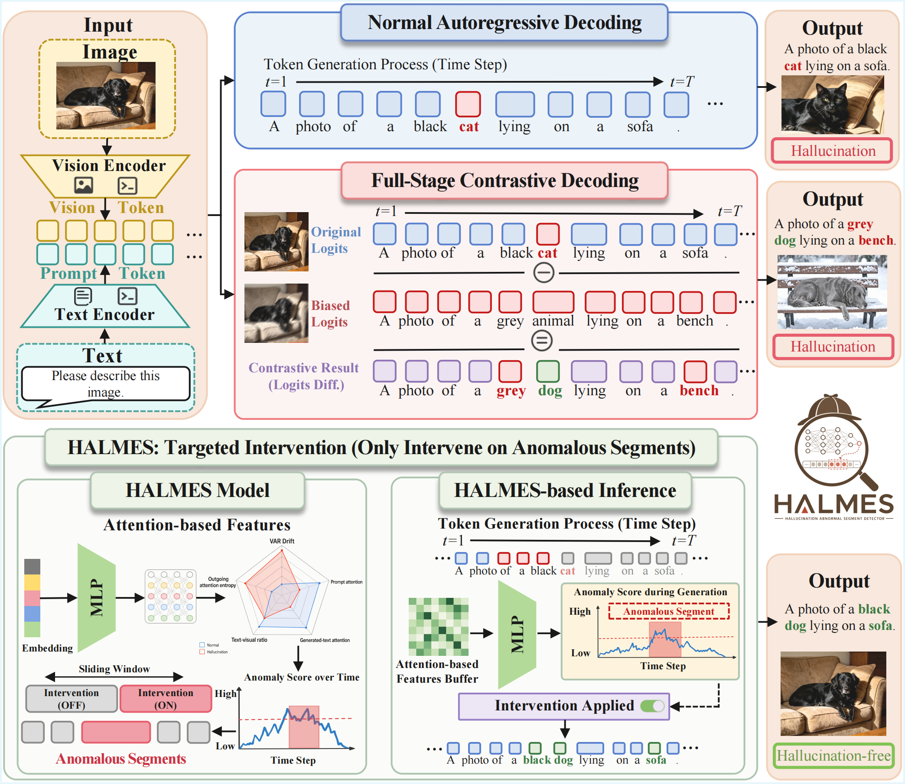

<h1 align="center">HALMES: Knowing When to Intervene<br>in LVLM Hallucination Mitigation</h1>

## News

- [2026-09-25] 🎉 HALMES has been accepted to **NeurIPS 2026**!

## Abstract

Contrastive decoding can mitigate hallucinations in large vision-language models, but applying it throughout generation introduces unnecessary intervention and computation. We introduce **HALMES**, a lightweight detector that uses internal attention features to estimate hallucination risk and selectively activate contrastive decoding. HALMES is trained on extracted features while keeping the underlying LVLM frozen, and can be integrated with different contrastive decoding methods.

<p align="center">
  <a href="managing/assets/framework.png">
    
  </a>
</p>
<p align="center"><em>HALMES intervenes selectively on segments identified as hallucination-prone.</em></p>

## Repository Structure

```text
.
├── halmes                                 // This directory contains all executable scripts.
│   ├── li-halmes-configurations           // Global configurations. Contains presets to avoid redundant setup across multiple scripts.
│   ├── li-halmes-generate-data            // Runs the LVLM on training datasets and records the attention features.
│   ├── li-halmes-label-data               // Annotates the previously extracted features with hallucination labels.
│   ├── li-halmes-split-datasets           // Handles dataset splitting and balancing.
│   ├── li-halmes-train-halmes             // Trains the proposed HALMES model.
│   ├── li-halmes-validate-checkpoints     // Evaluates checkpoints on the validation set (corresponding to Table 1 in the paper) to identify the optimal model.
│   ├── li-halmes-inference                // Runs various model variants on test datasets.
│   └── li-halmes-score-inference-outputs  // Scores the inference outputs (corresponding to Tables 2 and 3 in the paper).
├── lib                                    // Contains utility packages and shared libraries called by the executable scripts.
│   ├── halmes/li-halmes-model             // Includes the full definition of the HALMES model. If you wish to migrate HALMES to another project, you can use this package directly.
│   └── ...                                // Other general utility tools (not listed exhaustively).
├── managing                               // Used for global project management and organization.
│   ├── links                              // A dedicated directory for symbolic links. This allows you to keep code, models, inputs, and outputs on different file systems while maintaining a unified access path within the project.
│   └── ...
├── halmes.code-workspace                  // The VS Code workspace file.
└── README.md                              // This documentation file.
```

## Installation

Requires [uv](https://docs.astral.sh/uv/), and an NVIDIA GPU with enough memory for the target LVLM. Experiments were run on Ubuntu with NVIDIA A800 GPUs.

```bash
git clone https://github.com/slp-tongji/Halmes.git
cd Halmes

mkdir -p managing/links/outputs    # or, a more recommended approach is to create a symbolic link

# Initialize the feature-collection environment, as an example.
cd halmes/li-halmes-generate-data
uv sync
cd ../..
```

Each package has its own environment. Run commands from the indicated package directory; `uv sync` / `uv run` resolves and installs its dependencies automatically.

## Data and Configuration


| Component              | Supported options                        |
| ---------------------- | ---------------------------------------- |
| LVLMs                  | Qwen3-VL-8B-Instruct, InternVL3.5-8B-HF  |
| Detector training data | COCO`train2014`                          |
| Evaluation datasets    | COCO`val2014`, AMBER, Bingo, MMHal-Bench |
| Contrastive decoding   | VCD, M3ID, AvisC, SID, Self-Aug          |

Place local models and datasets under `managing/links/llms/` and `managing/links/datasets/`, or set their paths in `halmes/li-halmes-configurations/src/li_halmes_configurations/`:

<details>
<summary><b>Configuration files and evaluation dependencies</b></summary>


| Configuration file                    | Setting                             |
| ------------------------------------- | ----------------------------------- |
| `halmes_target_llm_configuration.py`  | Model paths and generation settings |
| `halmes_dataset_configuration.py`     | Dataset paths and judges            |
| `halmes_common_configuration.py`      | GPU device                          |
| `halmes_output_path_configuration.py` | Output paths                        |
| `halmes_tool_configuration.py`        | NLTK data and spaCy model paths     |
| `halmes_openai_llm_configuration.py`  | External judge endpoint and API key |

COCO labeling and scoring require NLTK resources. AMBER scoring also requires the spaCy model `en_core_web_lg`. Configure GPT-4o access for Bingo and MMHal-Bench. The current AMBER preset also initializes an API client, although its generative judge does not use it.

The default model folders are `Qwen3-VL-8B-Instruct` and `InternVL3_5-8B-HF`. Dataset folders are `MS-COCO`, `AMBER`, `Bingo`, and `MMHal-Bench`. The presets in `halmes_dataset_configuration.py` specify the expected files within each folder.

</details>

## Running HALMES

**Attention features → detector training → inference → evaluation.**

**All commands below start at the repository root and use Qwen3-VL.** For InternVL, replace `qwen3_vl_8b.py` with `intern_vl_3d5_8b.py`. Adjust each script's `Config` class to change datasets, methods, or sample counts.

### Attention Feature Collection

Collect attention features on COCO, label hallucinations, and prepare the detector's training and validation splits.

```bash
# 1. Generate captions and collect attention features.
cd halmes/li-halmes-generate-data
uv run src/halmes_generate_data_qwen3_vl_8b.py
cd ../..

# 2. Assign hallucination labels.
cd halmes/li-halmes-label-data
uv run src/halmes_label_data_qwen3_vl_8b.py
cd ../..

# 3. Split the detector dataset.
cd halmes/li-halmes-split-datasets
uv run src/halmes_split_datasets_qwen3_vl_8b.py
cd ../..
```

Prepared splits: `managing/links/outputs/halmes/datasets/qwen3_vl_8b/{train,validation}.pt`.

### Training

Train the HALMES detector and select the checkpoint with the highest validation AUROC. The LVLM weights remain frozen.

```bash
# Train the detector.
cd halmes/li-halmes-train-halmes
uv run src/halmes_train_halmes_qwen3_vl_8b.py
cd ../..

# Select the best checkpoint.
cd halmes/li-halmes-validate-checkpoints
uv run src/halmes_validate_checkpoints_qwen3_vl_8b.py
cd ../..
```

Selected checkpoint:

```text
managing/links/outputs/halmes/best_checkpoints/qwen3_vl_8b/1-36/halmes.pt
```

Keep the model ID and feature selector (`1-36` by default) consistent across training, validation, inference, and evaluation.

### Inference

Run generation with the selected checkpoint. If you already have a compatible detector, place it at the checkpoint path above and start here.

```bash
cd halmes/li-halmes-inference
uv run src/halmes_inference_qwen3_vl_8b.py
cd ../..
```

Select methods in `Config.llms()` and benchmarks in `Config.dataset()`. The default runs nucleus sampling, beam search, five CD methods, and their five HALMES variants across all four evaluation datasets.

Responses are saved to:

```text
managing/links/outputs/halmes/inference_outputs/qwen3_vl_8b/1-36/outputs.db
```

### Evaluation

Score the saved responses using the corresponding benchmark judges.

```bash
cd halmes/li-halmes-score-inference-outputs
uv run src/halmes_score_inference_outputs_qwen3_vl_8b.py
cd ../..
```

Per-sample scores are saved as SQLite databases under:

```text
managing/links/outputs/halmes/inference_outputs_scores/qwen3_vl_8b/1-36/
```

Aggregate scores according to each benchmark's metric definition. For a subset of benchmarks, update `Config.dataset_judge()` to match the inference configuration.

#### Add Your Own Dataset

1. **Load inputs:** implement `DatasetInputProvider` under `lib/data-loading/`. Provide `ids` and `get(id)`, which returns image/text messages. Follow an existing loader.
2. **Define scoring:** implement `SupportedJudge` in `halmes/li-halmes-score-inference-outputs/` with `ids`, `get_database_id(id)`, and `judge(id, response, log)`. Follow an existing judge wrapper.
3. **Connect both:** add dataset/judge presets in `halmes_dataset_configuration.py`, then select them in inference's `Config.dataset()` and evaluation's `Config.dataset_judge()`.
4. **Run:** add any new loader/judge package to the importing package's `pyproject.toml`, then run the inference and evaluation commands above. Use matching sample IDs in the loader and judge, and unique IDs across datasets.

To use the dataset for **detector training**, also implement a labeling judge in `halmes/li-halmes-label-data/` and select it in the feature-collection and labeling scripts.

> Each script prints its log location. Check `log.csv` and detailed logs for failed tasks before proceeding. `Done.` does not guarantee every task succeeded.

## Citation

<!-- BibTeX will be added here. -->
